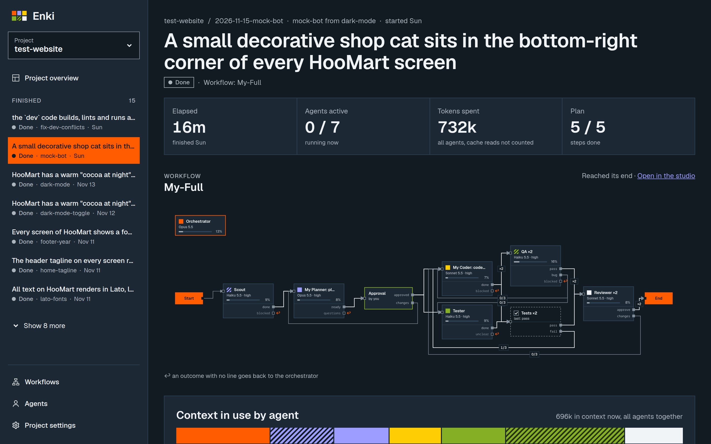
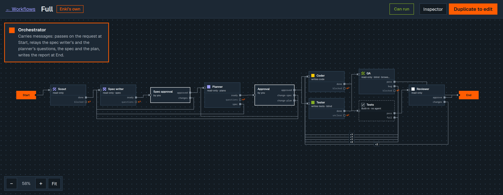

<p align="center"></p>

<h1 align="center">Enki</h1>

<p align="center">Enki turns Claude Code into a team lead: you describe a change, approve a spec of what to build and a plan of how, and a team of Claude agents explores, codes, tests, clicks through and reviews it in its own git worktree.<br>Hooks and a CLI enforce the process, not the model's memory, so nothing writes before you approve, each agent writes only what it may, and every loop has a limit.</p>

<p align="center"></p>

## Install

You need Claude Code 2.1.318 or newer, [herdr](https://herdr.dev) and Node 22 or newer. Enki is installed straight from this repository. In a terminal:

```
claude plugin marketplace add Nadir-Alishly/enki
claude plugin install enki@enki-plugins
```

This installs it at user scope, which enki needs: workers started in repo subfolders have to load the plugin too. Inside a Claude Code session, `/plugin marketplace add` and `/plugin install` do the same, but choose **user** scope when it asks, and run `/reload-plugins` if it tells you to.

Then open Claude Code in your project, inside a herdr pane:

```
/enki:init
```

Start a new session afterwards. It runs as the orchestrator: name a task, describe the change, and it begins. Enki does nothing in projects without `.enki/config.json`.

For QA's browser, type `! enki playwright install` at the Claude Code prompt once ([more](docs/servers-and-browser.md#browser-testing)). The `enki` command comes with the plugin, so it works inside Claude Code and not in your own terminal.

### Updating

```
claude plugin marketplace update enki-plugins
claude plugin update enki@enki-plugins
```

Then start a new session. Claude Code doesn't update enki by itself unless you turn on auto-update for `enki-plugins` in `/plugin`.

## What happens on a task

The orchestrator never writes code. It passes your request on and runs the team in visible herdr panes:

```
┌─────────────┬──────────┬──────────┬──────────┐
│    scout    │ planner  │  tester  │          │
├─────────────┼──────────┼──────────┤ reviewer │
│ spec writer │  coder   │    qa    │          │
└─────────────┴──────────┴──────────┴──────────┘
```

With enki's **Full** workflow, the default:

1. **Request.** You name the task and describe the change. The orchestrator writes down your words and passes them on: it carries messages between you and the team, and never plans or designs itself.
2. **Scout and spec writer.** The scout explores the code. The spec writer writes the spec from your request and the scout's findings: what is to be built and how it will be judged, with acceptance criteria and the public interface, never how to build it. Questions only you can answer come to you through the orchestrator, and your answers go back.
3. **Spec approval.** The orchestrator shows you the spec, word for word, in plan mode. Approve it, or ask for changes, which go back to the spec writer. The approved spec is saved as `spec.md`.
4. **Planner and approval.** The planner writes how to meet the spec: sub-goals, approach and steps, asking you only about the approach. It's shown to you the same way. Approve it, or ask for changes: to the plan, which go back to the planner, or to the spec, which go to the spec writer and then to you again. If the planner finds the spec can't be met, it sends it back to the spec writer instead of planning around it. Nothing changes before you approve both.
5. **Baseline.** `enki verify` records the current test results, so existing failures aren't blamed on the change.
6. **Tests and code, in parallel.** The tester writes tests from the spec, without seeing the code, while the coder implements.
7. **Verify and manual checks, in parallel.** Enki runs the tests itself, with no agent and no tokens, while QA starts the server and uses the software in a browser.
8. **Review.** The reviewer reads the diff once tests pass.
9. **Loops.** Failing tests, QA's bugs and the reviewer's changes go back to the coder, each at most 3 times. Past that, only you decide how to go on.
10. **Report.** Each repo's map (or notes) is updated, and you get a report with a scored retrospective on how the task was run.

A plan can pick another workflow, such as **Quick fix** (no scout: a short spec and plan, then the coder, tests and review), **Research** (read-only) or **Map** (builds a repo's [codebase map](docs/memory.md#the-codebase-map)), or one of your own: [agents and workflows](docs/agents-and-workflows.md) are yours to define, share and edit in the dashboard's studio.

<p align="center"></p>

Agents never commit. Each task works in its own git worktree, and when it finishes, enki commits the work to the task's branch. You review it, push it and merge it yourself.

## Documentation

| Page | What's in it |
|---|---|
| [Parallel tasks](docs/tasks.md) | Branches and worktrees, continuing a PR, ports, env files, databases |
| [Dev servers and browser testing](docs/servers-and-browser.md) | How enki runs your servers, and QA's browser |
| [Dashboard](docs/dashboard.md) | Every page of the local dashboard, and how it works |
| [Agents and workflows](docs/agents-and-workflows.md) | Making your own agents and workflows, sharing them, worker skills |
| [Memory](docs/memory.md) | The codebase map, and keeping memory in the repo or private |
| [Commands and configuration](docs/configuration.md) | Skills, the `enki` CLI, `.enki/config.json`, permission modes |
| [Security](docs/security.md) | What enki runs, reads and sends, what it enforces, and what it doesn't |

## Before you rely on it

Enki is a set of guardrails for a cooperative agent, not a sandbox. Its hooks refuse what they can see, and a script or an unusual shell form can do what they can't: the [limits](docs/security.md#what-is-not-enforced) are listed in full. It has no telemetry and no remote server, and it never pushes.

## Development

```
npm test
claude plugin validate .
```

To try a working copy, run Claude with `--plugin-dir` and set `ENKI_DEV_PLUGIN_DIR` to the same path, so workers load it too. Tests run against a fake herdr (`tests/helpers/fake-herdr.mjs`) whose responses were captured from real herdr. [`docs/spike-results.md`](docs/spike-results.md) records what was verified against the real tools.

For each release, raise the version in both `.claude-plugin/plugin.json` and `package.json`. Claude Code updates an installed plugin only when its version changes.

## License

Apache License 2.0. See [LICENSE](LICENSE).

If you build on enki or redistribute it, keep the [NOTICE](NOTICE) file with your copy and include its attribution in your documentation, as section 4 of the license requires.
